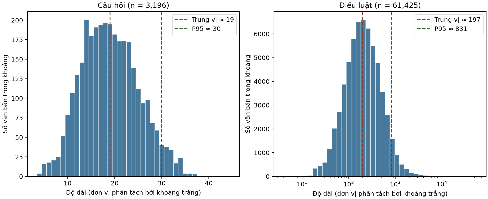

# CS221 · Truy hồi điều luật tiếng Việt

Đồ án môn Xử lý ngôn ngữ tự nhiên (CS221), UIT. Với một câu hỏi pháp lý bằng tiếng Việt, hệ thống xếp hạng các điều luật liên quan trong một kho văn bản cố định. Nhóm sẽ so sánh TF-IDF, BM25, bi-encoder và phương pháp kết hợp BM25 với bi-encoder (Hybrid).

**Tiến độ tuần 1.** Nhóm đã chuẩn hóa dữ liệu, cố định các tập câu hỏi và thống kê ngữ liệu. Các kết quả dưới đây mô tả dữ liệu dùng chung cho mọi mô hình.

## Dữ liệu và cách chia tập

Corpus gồm **61.425 điều luật**. Mỗi văn bản ghép tiêu đề với nội dung và được chuẩn hóa Unicode NFC. Có 357 văn bản chỉ có tiêu đề. Cả ba tập câu hỏi cùng truy hồi trên toàn bộ corpus.

| Tập | Câu hỏi | Cặp câu hỏi–điều luật có nhãn liên quan |
|---|---:|---:|
| Train | 1.926 | 1.992 |
| Dev | 482 | 488 |
| Test | 788 | 793 |
| Tổng | 3.196 | 3.273 |

Nhóm giữ nguyên 788 câu test gốc, loại 24 câu trùng test ở phía train, rồi tách 20% trong số 2.408 câu còn lại làm dev với seed 42. Kiểm tra trùng nội dung dùng Unicode NFC, chữ thường qua `casefold()` và chuẩn hóa khoảng trắng. Danh sách ID trong `data/splits/` xác định chính xác các tập. File `excluded_train_overlap_ids.txt` ghi lại 24 ID đã loại ở phía train.

Nguồn dữ liệu và phiên bản dùng trong đồ án: [GreenNode/zalo-ai-legal-text-retrieval-vn](https://huggingface.co/datasets/GreenNode/zalo-ai-legal-text-retrieval-vn/tree/12d76d4d04b94ceada970fcfbe7fec20bfa97389).

## Tái tạo kết quả tuần 1

Chạy các lệnh từ thư mục gốc của repo sau khi clone. Cần Python 3.12 và `curl`. Trên Ubuntu, nếu lệnh tạo môi trường báo thiếu `ensurepip`, cài gói `python3.12-venv` rồi chạy lại.

### 1. Chuẩn bị môi trường

```bash
python3 -m venv .venv
source .venv/bin/activate
python -m pip install numpy matplotlib
```

### 2. Tải bốn file dữ liệu gốc

```bash
(
  set -e
  mkdir -p data/raw/qrels
  revision=12d76d4d04b94ceada970fcfbe7fec20bfa97389
  base="https://huggingface.co/datasets/GreenNode/zalo-ai-legal-text-retrieval-vn/resolve/$revision"
  for name in corpus.jsonl queries.jsonl qrels/train.jsonl qrels/test.jsonl; do
    curl --fail --location --retry 3 "$base/$name" --output "data/raw/$name"
  done
)
```

### 3. Chuẩn hóa và thống kê

Dùng các file ID có sẵn trong `data/splits/`. Script tạo nhãn dev đọc nhãn từ train gốc vì các câu dev được tách từ tập này.

```bash
python src/prepare_corpus.py
python src/prepare_queries.py
python src/prepare_qrels.py
python src/length_stats.py
python src/plot_lengths.py
```

| File đầu ra | Nội dung |
|---|---|
| `data/processed/corpus.jsonl` | 61.425 dòng, mỗi dòng gồm `doc_id`, `text` |
| `data/processed/queries.jsonl` | 3.196 dòng, mỗi dòng gồm `qid`, `text` |
| `data/processed/qrels/{train,dev,test}.jsonl` | Mỗi dòng là một cặp `qid`, `doc_id` liên quan. Một câu hỏi có thể có nhiều cặp. |
| `results/length_stats.csv` | Bảng thống kê độ dài |
| `results/length_histograms.png` | Biểu đồ phân bố độ dài của câu hỏi và điều luật |

Ví dụ kiểm tra kết quả: `src/prepare_qrels.py` phải báo **482 câu hỏi và 488 cặp nhãn** cho dev. Khi chạy một mô hình trên dev, lấy câu hỏi theo `data/splits/dev_ids.txt`, xếp hạng trên toàn bộ corpus và chấm bằng `data/processed/qrels/dev.jsonl`. Định dạng kết quả nhóm thống nhất là `qid, doc_id, rank, score`, với hạng 1 là kết quả đứng đầu.

## Phân bố độ dài

Độ dài được đo bằng số đơn vị phân tách bởi khoảng trắng. Trung vị và phân vị 95 lần lượt là **19 và 30** đối với câu hỏi, **197 và khoảng 831** đối với điều luật. Trục ngang của biểu đồ điều luật dùng thang log để hiển thị cả các văn bản rất dài.


